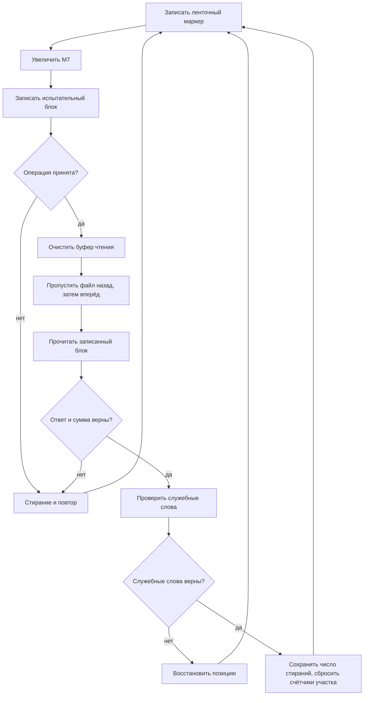

# Устройство ФОРМЕС: разметка лент ЕС-5017

`formes.be` восстанавливает зону `0616` тома `2053`. В ней находятся общий
переключатель программ разметки и программа разметки МЛ ЕС-5017.
Переключатель входит по адресу `00101`, разметчик — по `00131`.
Следующая загружаемая зона, `0617`, на исследованном томе полностью нулевая.

Разметчик работает через специальный ключ **`РАЗМЕС`**. Он записывает
ленточные маркеры и испытательные блоки, читает их обратно, проверяет
контрольную сумму и служебные слова, стирает плохие участки и повторяет
запись. Управление ЕС-5017 выполняет ОС.

Это статический разбор [formes.be](formes.be), сопоставленный с исходниками
Диспака БЭСМ-6 в `/home/leob/git/re-dispak`. Исполнение на физическом
накопителе не проверялось. Совпадение редакции исходников ОС с системой,
для которой собрана эта зона, не установлено. Адреса, номера зон, слова
и маски ниже восьмеричные. Номера разрядов и явно названные количества
десятичные; разряды нумеруются от 1 справа.

## Состав и размещение в памяти

| Адреса | Содержимое |
|---|---|
| `00001` | Параметр общего переключателя |
| `00010–00017` | Место для служебных слов прочитанного блока |
| `00020` | Вход авостного завершения: переход в `ИТОГ` |
| `00021–00031` | Заготовки заказов `Э70` |
| `00032–00100` | Состояние, ключи, константы и маски |
| `00101–00111` | Общий переключатель программ |
| `00113–00130` | Команды и таблицы переключателя |
| `00131–00437` | Инициализация, основной цикл, восстановление, диагностика |
| `00440–00572` | Формирование последующего задания и печатного протокола |
| `00573–00746` | Константы, шаблоны сообщений и задания |
| `00747–03537` | Обнуляемая рабочая область, включая печатный буфер и таблицы дефектов |
| `04000–04004` | Временно исполняемый загрузчик, затем часть испытательного буфера |
| `04000–05777` | Испытательный блок: 1024 слова |
| `06000–07777` | Буфер контрольного чтения: 1024 слова |

При входе `00131` цикл с `М16 = -1400` очищает 1401 слово от `00747`
до `03537` включительно. Таким образом, рабочая область выходит за пределы
одной дисковой зоны с исходным образом.

## Общий переключатель

По адресу `00101` выбирается индекс `memory[1] AND 3`. По нему берутся
два информационных слова чтения и команда перехода:

| Индекс | Ветвь | Зоны на логическом устройстве `041` | Вход |
|---|---|---|---|
| 0 | РАЗ, МЛ БЭСМ-6 | `0612`, `0613` | `00030` |
| 1 | ПАК, ветвь БРЕГЕТ | `0713`, `0714` | `00001` |
| 2 | РЗД, МД | `0614`, `0615` | `00021` |
| 3 | РЗЕ, МЛ ЕС | `0616`, `0617` | `00131` |

В `04000–04001` помещаются информационные слова, в `04002–04003` через
`Э75` записываются команды `Э70`, в `04004` — выбранный переход.
Затем управление передаётся на `04002`. Исполняемые команды находятся
выше двух заменяемых страниц `00000–03777`, поэтому чтение не уничтожает
ещё не исполненную часть загрузчика.

Для РЗЕ первая зона читается повторно, вторая заполняет следующую страницу
нулями. Сама программа разметки после этого начинает работу в `00131`.
Формирование задания и проверка содержимого зон описаны в
[directives.md](directives.md).

## Связь с ОС: РАЗМЕС

На входе разметчик задаёт обработку завершения, очищает рабочую память
и выдаёт `ПОСТ.МЛ ЕС5017 НАРАЗМ.`. Затем вызывает:

```text
СЧ  КЛЮЧЕС       П'РАЗМЕС'
Э70 0
```

Вход `Э70` сравнивает сумматор с `КОНРЗ = П'РАЗМЕС'` и переходит в `РЗЕС`:
[khlam.be:115](/home/leob/git/re-dispak/khlam.be:115),
[esml.be:427](/home/leob/git/re-dispak/esml.be:427).

В `рзес` ненулевой `ШРЕС` означает занятую разметку; ответ — разряд 48
сумматора. При свободном состоянии ОС записывает позиционный признак
задачи в `ШРЕС` и закрывает задачу до задания оператора.
[esml.be:1621](/home/leob/git/re-dispak/esml.be:1621).

Ветвь приказа 24 для ЕС проверяет наличие задачи и задания, номер бобины
и состояние МГ, затем заполняет `РЗМГЕС`.
[esml.be:1654](/home/leob/git/re-dispak/esml.be:1654).
При опознании указанного накопителя `мл1ес` формирует ответ:
номер бобины, сдвинутый на 6 разрядов, и физический номер МГ.
[esml.be:1589](/home/leob/git/re-dispak/esml.be:1589).

Программа выделяет:

- `БОБИНА = (ответ AND 777700) >> 6`;
- `МГНАПР = ответ AND 77`.

Операции выполняются с тем же ключом и ненулевым адресом информационного
слова. Особый вызов **`Э70 1`** освобождает разметку: ОС снимает признаки
в таблице накопителя и обнуляет `ШРЕС`, `РЗМГЕС`.
[esml.be:1634](/home/leob/git/re-dispak/esml.be:1634).
Именно этот вызов находится в `ВЫХОД`: адрес метки `ПАРАМ` равен 1.

Это отдельный интерфейс от `КЛЮЧРЗ` и `РЕЖРАЗ`, описанных в
[os-protocol.md](os-protocol.md). Здесь операция задаётся непосредственно
информационным словом `Э70`; общего слова `РЕЖРАЗ` программа не использует.

## Таблица операций

Все заготовки `00021–00031` имеют разряд 28 — признак разметки ЕС.
При формировании физического заказа ОС превращает его в разряд 30 КУС.
При завершении такого заказа возвращает аппаратный ответ разметчику
и передаёт служебные слова в `00010–00017`.
[esml.be:368](/home/leob/git/re-dispak/esml.be:368),
[esml.be:1185](/home/leob/git/re-dispak/esml.be:1185).

Код операции занимает разряды 42–40. В заготовке `00021` дополнительно
установлен разряд 27, меняющий операцию 7 с записи маркера на стирание.
Декодирование подтверждается ветвью `ФЗК`:
[esml.be:249](/home/leob/git/re-dispak/esml.be:249).

| Адрес | Слово | Операция |
|---|---|---|
| `00021` | `0070001400300000` | Стирание участка |
| `00022` | `0060001000300000` | Перемотка к началу |
| `00023` | `0020001000300000` | Пропуск блока вперёд; в основной последовательности не вызывается |
| `00024` | `0040001000300000` | Пропуск файла вперёд, за маркер |
| `00025` | `0030001000300000` | Пропуск блока назад |
| `00026` | `0050001000300000` | Пропуск файла назад, перед маркер |
| `00027` | `0010031000300000` | Чтение блока в страницу `06000–07777` |
| `00030` | `0000021000300000` | Запись блока из страницы `04000–05777` |
| `00031` | `0070001000300000` | Запись ленточного маркера |

После регистрации выполняется также обычный заказ `0000030000100000`,
полученный сложением констант `00043` и `00064`. Его следует отличать
от вызовов с ключом на сумматоре: в этом месте сумматор содержит само
полученное информационное слово. По полям обычного заказа МБ это запись
страницы `06000–07777` на логический МБ `010`, тракт 0. Назначение этой
записи в общем окружении задачи отдельно не установлено.

## Подготовка испытательного блока

В `00150–00154` строится блок:

- `04000–05776`: чередуются слова `5252525252525252` и `2525252525252525`;
- `05777`: слово `6666666666666666`.

Первое слово получается инверсией `2525252525252525`. Всего в основном
участке 1023 слова: 512 первых и 511 вторых. С последним словом
циклическая сумма всех 1024 слов равна **`4141414141414141`** — константе
`00040`. Эта арифметическая связь проверена независимо по словам образа.

Программа не сравнивает каждый прочитанный бит с эталоном: основная
программная проверка данных — циклическое суммирование блока. Также
проверяются аппаратный ответ и служебные слова.

После подготовки буфера выполняется перемотка к началу. Цикл с `М1 = -10`
допускает 11 обращений. При `М16 = 1` начальная позиция найдена:
`М7` устанавливается в 1 и выполняется стирание через `ОБМЕН`.
Если нужный ответ не получен, печатается `НЕТ ПЕРЕМОТКИ МГ`.

## Основной цикл разметки

Нормальная последовательность `00162–00203`:



Каждому испытательному блоку предшествует ленточный маркер. Номер `М7`
на первом проходе равен 2. Перед чтением весь буфер `06000–07777`
обнуляется. Затем 1024 слова суммируются командой `СЛЦ`; результат
сравнивается с `00040`.

В основном цикле нет отдельного счётчика, останавливающего разметку
после заранее заданного числа зон. Штатный предел прохода задаётся
ответом конца ленты; другие пути завершения перечислены ниже.

В печатном итоге и последующем задании количество зон вычисляется с
вычитанием `10` восьмеричного из `М7`. Это согласуется с наличием шести
начальных номеров `2–7` до первого номера `10`. Развёртка физического
носителя на реальной аппаратуре здесь не проверялась.

## Проверка служебных слов

Подпрограмма `ПРОВЕР`, адреса `00250–00265`, сбрасывает признак ошибки
`00033` и проверяет:

1. `СС3 OR СС6`, то есть `memory[13] OR memory[16]`, против ожидаемого
   сочетания номера `М7`, его старшей части и константы `00047`.
2. `СС7`, ячейку `00017`, против `4141414141414141`.
3. Номер бобины в `СС2`, ячейке `00012`: принимается совпадение младшей
   копии либо копии после сдвига вправо на 30 разрядов; маска — `7777`.

Точное ожидаемое значение первой проверки:

```text
(М7 OR ((М7 >> 1) << 13)) XOR 0007070700000000
```

В этой формуле числа сдвигов 1 и 13 десятичные. При расхождении
ненулевой результат записывается в `00033`.

При неверных служебных словах путь `00237` дополнительно проверяет равенство
`СС3` и `СС6` и поле `СС3 AND 0007777700000000`. Если заголовок согласован,
программа восстанавливает `М7` из младших 11 разрядов `СС3`. Иначе
продолжает восстановление позиции, включая движение назад и чтение.

## Состояние и регистры

| Место | Назначение в основном цикле |
|---|---|
| `М2` | Адрес возврата из `РЕЖОБМ` |
| `М3` | Состояние повторов внутри `РЕЖОБМ` |
| `М4` | Общее число заходов в ветвь ошибок `00266` |
| `М5` | Число стираний, накопленное перед текущей зоной |
| `М6` | Число записей в таблице дефектных зон |
| `М7` | Текущий номер зоны |
| `М10` | Отрицательный счётчик последовательных восстановлений от начала |
| `М11` | Адрес возврата из вспомогательных подпрограмм |
| `00032` | Операция не восстановлена внутренними повторами |
| `00033` | Результат проверки служебных слов |
| `00034` | Текущий заказ: заготовка операции OR М7 |
| `00035` | Заказ, сохранённый для повтора |
| `00036` | Сохранённое продолжение вызывающего кода |
| `00052` | Ответ последнего `Э70` из `РЕЖОБМ` |
| `00055` | Номер бобины |
| `00056` | Физический адрес МГ |

В печатных подпрограммах назначение регистров меняется. Например, `М4`
используется как регистр возврата из `ПРОБЕЛ`; общий счётчик до этого
сохраняется в ячейке `00641`.

## Два уровня восстановления

### Повтор операции в РЕЖОБМ

`РЕЖОБМ`, адреса `00307–00340`, добавляет `М7` к заготовке операции через
`ИЛИ`, вызывает `Э70` с ключом и разбирает ответ. Разряд 48 сумматора ведёт
к сообщению о выключенном МГ. При записи и чтении дополнительно проверяются
маски аппаратного ответа:

| Маска | Разряды | Реакция |
|---|---|---|
| `20201` | 1, 8, 14 | Повтор через ветвь `00320` |
| `1000` | 10 | Повтор при операции с нулевым кодом, то есть записи |
| `2000` | 11 | Переход к восстановлению позиции при чтении |
| `10400` | 9, 13 | Повтор при чтении |

Это фактические тесты программы. Полная аппаратная расшифровка каждого
разряда регистра ошибок ЕС-5017 здесь не установлена. ОС возвращает
`УВВ 4117` и добавляет ошибку ОШМ:
[esml.be:1185](/home/leob/git/re-dispak/esml.be:1185).

Обычный путь повтора начинается с `М3 = -4`. В `00211` он увеличивается:
при первом входе сохраняется продолжение, затем выполняются движение
назад через файл, движение вперёд и повтор сохранённого заказа. Если он
проходит, `М3` сбрасывается и выполняется сохранённое продолжение.
При достижении нуля выставляется `00032 = 1`. Для повторяющейся ошибки
одного заказа это исходная неудача и три попытки восстановления.
Ошибки самих операций позиционирования проходят через тот же обработчик.

Код в `М16` разбирается отдельно: ноль допускает возврат, наличие бита
со значением 4 ведёт к восстановлению позиции, точное значение 3 и
нечётные значения допускают возврат, оставшееся значение с битом 2
ведёт к `КОНЕЦ ЛЕНТЫ`. ОС различает начало и конец ленты значениями
1 и 2, маркер — значением 3:
[esml.be:1120](/home/leob/git/re-dispak/esml.be:1120).

### Стирание плохого участка и повтор разметки

При невосстановленной записи/чтении или неверной сумме путь `00266`:

1. Сбрасывает `00032` и выполняет стирание.
2. Если получен ответ начала ленты, переходит в восстановление от начала.
3. Иначе увеличивает `М5` и `М4`.
4. Добавляет `М7` в таблицу, если этот номер отличается от последней записи.
5. При `М5 = 10` восьмеричное печатает `БОЛЬШЕ 7 СТИРАНИЙ В ЗОНЕ`.
6. Уменьшает `М7`, ещё раз стирает через `ОБМЕН` и возвращается к записи
   маркера; следующее увеличение `М7` сохраняет номер повторяемой зоны.

После успешной проверки накопленное `М5` записывается в параллельную
таблицу и обнуляется, `М10` также сбрасывается.

При потере позиции путь `00302` уменьшает `М10`. Если младшие три бита
стали нулями, то есть на восьмом последовательном заходе после сброса,
выдаётся то же сообщение о стираниях. Иначе выполняется серия вызовов
`ОБМЕН` со счётчиком `М1 = М10`: на k-м таком заходе — k+1 вызовов
стирания. Затем начинается новый проход основного цикла.

Путь восстановления `00225–00244` использует пропуск файла назад,
пропуск блока назад и чтение, пока не получит пригодные служебные слова.
Поэтому повреждение заголовка может вызвать поиск предыдущего надёжного
места, а не немедленную окончательную остановку.

## Таблицы дефектов и итог

Номера дефектных зон записываются начиная с `02244`; счётчик — `М6`.
Повторная ошибка той же зоны не добавляет новую строку. В параллельной
таблице с адресом `02717 + индекс` хранится число стираний; первая запись
имеет индекс 1, то есть адрес `02720`.

В `ИТОГ`, адреса `00467–00572`, формируются номер бобины, адрес МГ, дата,
число зон и общее число ошибок. Нулевое число ошибок печатается как `НЕТ`.
Если таблица дефектов пуста, выдаётся `ДЕФЕКТОВ НОСИТЕЛЯ НЕ ОБНАРУЖЕНО!`.

При обходе таблицы номера меньше `10` восьмеричного пропускаются:
печатный список относится к зоне данных после начального участка.
Для каждой строки формируются порядковый номер, номер дефектной зоны
с вычитанием `10` и число стираний перед зоной. Каждая строка занимает
шесть слов в печатном буфере. Явных проверок границ таблиц и этого буфера
в перечисленных циклах нет.

## Диагностика и завершение

| Сообщение | Условие в программе |
|---|---|
| `ЦП ЗАНЯТ РАЗМЕТКОЙ` | Разряд 48 ответа на регистрацию |
| `НЕТ РАЗРЕШЕНИЯ ЗП НА МГ` | Разряд 47 ответа при начальной перемотке |
| `НЕТ ПЕРЕМОТКИ МГ` | Начальная серия обращений не дала точного ответа `М16 = 1` |
| `НЕТ СТИРАНИЯ НА МГ` | Вызов стирания через `ОБМЕН` вернул ненулевой `М16` |
| `ВЫКЛЮЧЕН МГ` | Разряд 48 ответа в `РЕЖОБМ` |
| `БОЛЬШЕ 7 СТИРАНИЙ В ЗОНЕ` | `М5 = 10` либо исчерпан счётчик восстановлений `М10` |
| `КОНЕЦ ЛЕНТЫ` | Ветка разбора `М16`, завершающаяся в `00370` |

Занятая регистрация заканчивается непосредственно `Э74`. Отказ записи
или перемотки идёт через `ВЫХОД`. Конец ленты, ошибки стирания,
выключение и исчерпание повторов идут через `ИТОГ`.
Авостный вход `00020` также ведёт в `ИТОГ`.

После итога подпрограмма `ФОРЗАД`, адреса `00440–00457`, при ненулевом
номере бобины формирует новое задание через `Э50 7701`. В шаблоне стоят:

- шифр `415507`;
- стандартный паспорт `ЗС,`;
- загрузочный адрес `5000`;
- упакованные сведения о разметке и общий счётчик ошибок.

Инструкция ОС связывает шифр `415507` с программой **`УНМЛМД` — уничтожение
информации о бобине в диагностическом архиве**, вызываемой после разметки.
Поэтому это задание нельзя описывать просто как печать статистики.
[rukava.be:4586](/home/leob/git/re-dispak/rukava.be:4586).
Само исполнение `УНМЛМД` в этот разбор не входит.

После формирования задания выполняются освобождение разметки через
`Э70 1` с ключом `РАЗМЕС` и завершение `Э74`.

## Проверка исходника

Команда воспроизведения:

```sh
python3 format/build-formes.py
```

Существующий отчёт `build/formes/comparison.json` относится к текущему
`formes.be`: SHA-256 исходника совпал. В отчёте БЕМШ имеет ноль ошибок,
результат ЗОНГП совпадает с `2053/0616` во всех 1024 словах, 6144 байтах.
SHA-256 зоны:

```text
7f6db0b84da980f31cb24beb8495b38a4c29b6cdebcd0175b0ab83aefd89fff3
```

При этом разборе исходник не менялся. Проверены декодирование заготовок
операций по словам образа, границы очистки памяти и циклическая сумма
испытательного блока. Эти проверки не являются проверкой работы с МГ.
