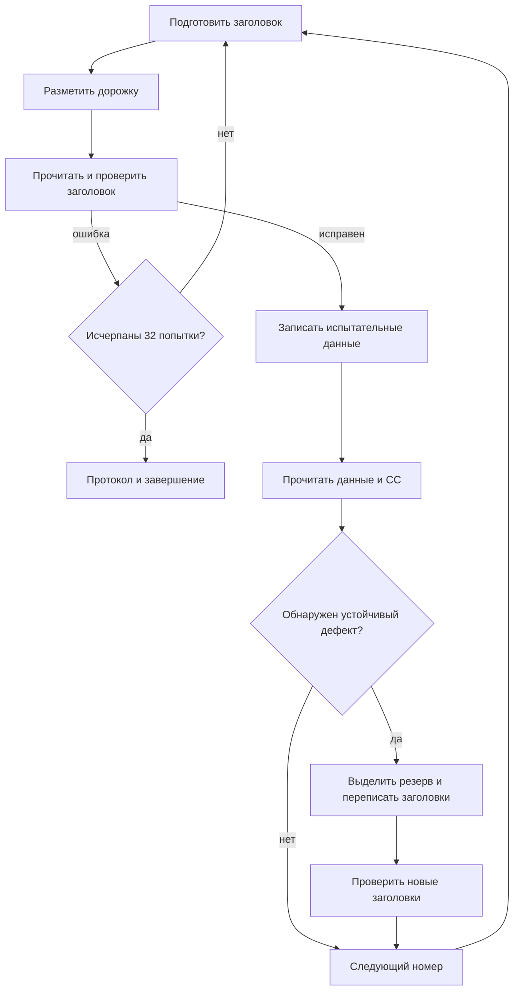

# Устройство ФОРММД: разметка магнитных дисков

`formmd.be` — программа из зон `2053/0614–0615`. Она формирует заголовки
дорожек, записывает испытательные данные, проверяет прочитанные заголовки,
служебные слова и данные. Устойчиво неисправным дорожкам назначаются
резервные; адреса замены записываются в заголовки на диске.

Работа начинается по входу `00021` из общего переключателя разметки.
Путь вызова по приказу РЗД описан в [directives.md](directives.md).
Соседний вход `00022` включает режим 3 с принудительной браковкой
номеров из списка в памяти.

Разбор статический, по [formmd.be](formmd.be) и исходникам ОС БЭСМ-6
в `/home/leob/git/re-dispak`. Версия работающей вместе с образом ОС
и работа на физическом накопителе не проверялись. Адреса, слова,
маски и номера в приведённых списках восьмеричные; количества попыток,
длины массивов, номера разрядов и явно оговорённые числа десятичные.
Разряды нумеруются от 1 справа.

## Карта программы и памяти

| Адреса | Назначение |
|---|---|
| `00010–00017` | Служебные слова, возвращаемые ОС после чтения |
| `00020` | Авостный вход: переход в `КОНЕЦ` |
| `00021`, `00022` | Входы с `РЕЖИМ = 0` и `РЕЖИМ = 3` |
| `00023–00115` | Регистрация, выбор типа и начальная подготовка |
| `00116–00220` | Разметка и проверка очередного номера |
| `00221–00437` | Выделение замены, обработка смежных дефектов и отказа резерва |
| `00440–00455` | Сообщения о занятой разметке и исчерпании резерва |
| `00456–00507` | Освобождение, итог и формирование последующего задания |
| `00510–00673` | Заказы ОС, классификация ошибок и выделение резерва |
| `00674–00753` | Тексты аппаратных ошибок |
| `00754–01151` | Формирование и распаковка заголовка |
| `01152–01204` | Испытательные данные и ожидаемые служебные слова |
| `01205–01640` | Анализ расхождений и печатный протокол |
| `01641–02440` | Константы, рабочие слова, шаблоны сообщений и заказов |
| `02441–02534` | Таблица занятости резервных номеров, до 60 элементов |
| `02535–03057` | Рабочие данные анализа расхождений |
| `03060` | Режим работы |
| `03061–03116` | Список принудительной браковки, 30 элементов |
| `03117–03144` | Состояние восстановления, ожидаемые СС и распакованный заголовок |
| `04000–05777` | Испытательный блок и область построения заголовка |
| `06000–07777` | Буфер чтения |
| `10000–10767` | До восьми записей подробного протокола, по 63 слова |

В обеих дисковых зонах есть содержательные части программы. Во второй
продолжается код, затем идут константы, шаблоны и начальное содержимое
рабочих таблиц. Ненулевой хвост `03061–03114` используется самой программой.

## Регистрация и взаимодействие с ОС

В `00023` сохраняется режим и обнуляется `М14`, смещение в накопительном
печатном буфере. Затем программа задаёт обработку завершения, загружает
`КЛЮЧРЗ` на сумматор, устанавливает `М12 = -3075` и вызывает `Э70 0`.
Ненулевой ответ ведёт к `ЦП ЗАНЯТ РАЗ.ДИСКА` и `Э74`.

Это дисковая ветвь общего ключа: `блразм → рзмд → рзм` выбирает состояние
разметки МД, используя также `М12`. Для неё проверяются `РАЗМГ+1`
и `ШЗРАЗМ+1`.
[vzu.be:187](/home/leob/git/re-dispak/vzu.be:187).

После сообщения `ПОСТ.МД НА РАЗМ.` выдаётся специальный заказ `Э70 01647`.
Заказ содержит разряды 37 и 36. Если оператор ещё не определил устройство,
ОС закрывает задачу до задания на разметку.
[vzu.be:1290](/home/leob/git/re-dispak/vzu.be:1290).

Приказ 24 связывает задачу с пакетом и устройством. Для МД предназначена
ветвь `G50147`; после включения накопителя обработчик опознания заполняет
таблицу устройства и пробуждает разметчик.
[prik3.be:233](/home/leob/git/re-dispak/prik3.be:233),
[avmd.be:199](/home/leob/git/re-dispak/avmd.be:199).
Инструкция оператора описывает этот порядок в
[rukava.be:3679](/home/leob/git/re-dispak/rukava.be:3679).

Тип берётся из ответа: `(СМ >> 40) AND 3`, где 40 — десятичное число,
и сохраняется в `ТИПМД`. Затем выполняется пауза `Э50 7700` с `Е7`
на сумматоре. Это 64 единицы по 80 мс, то есть 5,12 с по описанию экстракода.
[Dispak-programmer-guide.md:3661](/home/leob/git/besm6.github.io/wiki/Dispak-programmer-guide.md:3661).

Операции разметки МД задаются непосредственно информационным словом `Э70`.
Общее слово `РЕЖРАЗ` ленточного разметчика здесь не используется.
Драйвер ОС распознаёт тестовый заказ и выдаёт указанный тип команды КМД:
[diski.be:805](/home/leob/git/re-dispak/diski.be:805),
[diski.be:1688](/home/leob/git/re-dispak/diski.be:1688).

## Два типа диска

Код рассчитан на `ТИПМД = 0` или `1`; отдельной проверки других значений нет.
Инструкция ОС называет диски ёмкостью 7,25 и 29 Мбайт. Установленные
в машинном коде различия:

| Свойство | `ТИПМД = 0` | `ТИПМД = 1` |
|---|---|---|
| Проверяемые данные за чтение | 512 слов | 1024 слова |
| Сравниваемые СС | 4 выбранных по чётности номера | Все 8 |
| Разряд 23 заказа | Сохраняется нулём: обмен дорожкой | Устанавливается: обмен зоной |
| Выбор половины страницы | По младшему разряду номера | Не добавляется |
| Граница рабочей части в `01736/01737` | `03720` = 2000 | `07640` = 4000 |
| Начальное значение счётчика полного прохода | −2029 | −4059 |
| Проверяемых номеров при старте с нуля | 2030 | 4060 |
| Элементов таблицы резерва | 30, `02477–02534` | 60, `02441–02534` |
| Сообщение при исчерпании | `ДЕФЕКТНЫХ ДОРОЖЕК > 30` | `ДЕФЕКТНЫХ ДОРОЖЕК > 60` |

Счётчики включают область резервных номеров. В `00107` при достижении
границы рабочей части выставляются другие идентификаторы заголовка.
Поэтому числа полного прохода нельзя целиком считать числом пользовательских
зон. Для типа 0 программа отдельно учитывает чётность и соседство дорожек
в зоне; для типа 1 обрабатывает полный блок.

## Входы и дополнительные режимы

Обычный вход `00021` начинает с нулевого `РЕЖИМ`, соседний `00022` — с 3.
При этом `РЕЖИМ` может изменяться и в процессе восстановления.

В `00043–00077` есть дополнительный путь, зависящий от содержимого `М12`
после начальных вызовов ОС. Если исходный режим нулевой и `М12 >> 1`
ненулевой, программа:

1. Выделяет номер как `(М12 >> 1) AND 7777`.
2. Выделяет новый режим как `М12 >> 13` (сдвиги десятичные).
3. Очищает список `03061–03116` и помещает в его начало подготовленные
   соседние номера.
4. Выполняет 30 предварительных обращений к резервной области.
5. Переходит к обработке выбранных номеров.

Если этот путь не выбран, в `00103` задаётся полный проход от нуля.
Происхождение дополнительного содержимого `М12` в реальном операторском
сценарии отдельно не установлено; это не параметр по адресу 1 общего
загрузчика. Параметр загрузчика для РЗД выбирает саму программу, вход `00021`.

### Принудительная браковка

В `ОБМЕН` после успешного чтения проверяется младший бит `РЕЖИМ`.
Если он установлен, команда была чтением с кодом 3 и текущий ненулевой
номер найден в `03061–03116`, программа записывает все единицы в `06310`.
Затем возвращается с нулевым результатом операции.

Таким образом, аппаратное чтение может быть исправным, но последующее
сравнение данных обнаружит внесённое программой расхождение и запустит
обычный механизм браковки. Это следует из ветви `00543–00554` в
[formmd.be:569](/home/leob/git/leobru/dispak-tools/format/formmd.be:569).

В исходном образе список содержит 28 ненулевых номеров и два нуля:

```text
0040 0043 0044 0045 0050 0053 0054 0055 0056 0057
0061 0062 0064 0065 0066 0067 0070 0073 0074 0075
0076 0077 3724 3734 3735 3740 3746 3753 0000 0000
```

Вход `00022` сохраняет этот список. Происхождение его начального
содержимого неизвестно; установлено его использование кодом данного образа.

## Заказы Э70

`ОБМЕН`, адрес `00510`, получает номер операции в `М1`. Он объединяет
заготовку `02430 + М1` с номером, идентификаторами, выбором половины страницы
и признаком разметчика — разрядом 37.

| `М1` | Заготовка | Операция КМД |
|---|---|---|
| 1 | `02431` | Сброс на нулевой цилиндр |
| 2 | `02432` | Подвод на заданный цилиндр |
| 3 | `02433` | Чтение данных |
| 4 | `02434` | Запись данных |
| 5 | `02435` | Разметка дорожки |
| 6 | `02436` | Сравнение кодов |
| 7 | `02437` | Чтение заголовка |

В основном цикле непосредственно используются 2, 3, 4, 5 и 7. Наличие
заготовок 1 и 6 не означает отдельного вызова каждой из них программой.

В информационном слове значимы разряды:

- 40 — чтение;
- 38 — последнее обращение, освобождение разметки;
- 37 — заказ разметчика;
- 36 — тестовый режим;
- 35–31 — страница обмена;
- 27–26 — идентификатор;
- 25 — чётность дорожки;
- 24 — чтение служебных слов;
- 23 — обмен зоной вместо дорожки;
- 22 — вторая половина страницы;
- 21–19 — код команды.

Структура приведена в [rukava.be:3817](/home/leob/git/re-dispak/rukava.be:3817).

После `Э70` сохраняются `ОТВЕТ` и выделенные поля: ОШМ в `02023`,
тип команды в `02025`, младшие 24 разряда ответа в `02026`, пакет
в `02033`. Затем вызывается классификатор ошибок `00565`.

В тестовом режиме ОС возвращает физический адрес устройства в разрядах
48–43, номер пакета в 36–25, ОШМ в 37 и состояние РС в младших разрядах.
При чтении передаёт служебные слова в память задачи.
[diski.be:1214](/home/leob/git/re-dispak/diski.be:1214),
[diski.be:1245](/home/leob/git/re-dispak/diski.be:1245).

## Основной цикл: заголовок, данные, замена



### Заголовок

В `00116` вызываются подготовка, команда 5 и команда 7. Подпрограмма
`01110` распаковывает прочитанные поля и проверяет адрес, адресный маркер
и контрольную часть. Первый обнаруженный дефект записывается в протокол.
При ошибке цикл повторяется; после 32 неудач управление идёт через `00130`
к итогу. Это предел **попыток разметки и проверки заголовка**, отдельный
от пределов проверки данных.

При неудаче проверки уже изменённых заголовков используется аналогичный
цикл `00325–00333`, который ориентируется на ответ команды чтения.

### Данные и служебные слова

В `00140` строится чередующийся код на основе
`2525252525250000 OR текущий_номер`. Буфер `04000–05777` заполняется
попеременно этим словом и его инверсией. Затем выполняются запись командой 4
и чтение командой 3.

ОШМ после записи ведёт к диагностике немедленно. После чтения сравниваются
ожидаемые СС в `03125–03134` и возвращённые в `00010–00017`, затем
побитово сравниваются данные через `НТЖ`:

- 512 слов для типа 0;
- 1024 слова для типа 1.

Если первый проход исправен, программа сразу переходит к следующему номеру.
После первого расхождения продолжает чтения со счётчиком `М13 = -4`,
то есть в серии может быть до пяти чтений. При втором расхождении
перезаписывает испытательный код и начинает новую серию. Если во второй
серии вновь получены два расхождения, переходит к замене.

Состояние серии хранится в `02043`, признак уже выполненной повторной записи —
в `02044`. Единственное расхождение в серии само по себе ещё не означает
назначения резерва. Ссылки: [formmd.be:159](/home/leob/git/leobru/dispak-tools/format/formmd.be:159),
[formmd.be:183](/home/leob/git/leobru/dispak-tools/format/formmd.be:183),
[formmd.be:194](/home/leob/git/leobru/dispak-tools/format/formmd.be:194).

## Формирование заголовка

`ПОДГОК`, адрес `00754`, очищает рабочий участок и строит две части
заголовка по `02030` и `02031`. `02032` определяет, как получить адрес
второй части: повторить адрес первой, использовать выделенную замену
или прочитать обратное соответствие из таблицы резерва.

В `01053` внутренний номер N переводится в адрес:

```text
u = 2*N  для типа 0;  u = N  для типа 1
адрес = 32*(u div 20) + (u mod 20)
```

Числа 2, 32 и 20 в этой формуле десятичные. Частное и остаток получаются
повторным вычитанием константы `24` восьмеричного, а частное накапливается
с шагом `Е6`. Кодирование соответствует разделению номера на цилиндр
и головку; в типе 0 используются чётные значения младшего поля.

`01064` формирует контрольную часть: обрабатывает шестибитные группы,
обращает порядок битов, складывает их и дополняет результат. Затем
`01032–01042` раскладывают поля по маске `0410204102041020` в слова
для аппаратуры. Обратная распаковка находится в `01115–01127`.

Документация задаёт заголовок как последовательность адресного маркера,
идентификатора, адреса и контрольной суммы; вторая часть содержит повтор
либо адрес замены.
[rukava.be:3757](/home/leob/git/re-dispak/rukava.be:3757).
Там идентификатор `10` указан дважды с разными описаниями. В программе
фактически используются значения 0, 1, 2 и 3:

- 0 — обычный проход рабочей части;
- 1 — перепись заголовка с назначенной заменой;
- 2 — резервная часть;
- 3 — ветви обработки связанных соседних дефектов.

Назначение полей подтверждается путями их формирования; повторять
дублирующееся обозначение из инструкции как полную таблицу кодов нельзя.

## Резерв и переназначение

`БРАК`, адрес `00661`, ищет нулевой элемент таблицы. В занятую ячейку
записывается исходный номер с разрядом 48. Номер выделенной замены
возвращается в `01712`; ноль означает исчерпание резерва.

Для типа 0 индекс таблицы идёт от −29 до 0, для типа 1 — от −59 до 0.
Номер замены вычисляется добавлением `3755`, а для типа 1 — ещё `3756`.
Первая свободная запись поэтому соответствует 2000 для типа 0 и 4000
для типа 1, в десятичной записи.
[formmd.be:758](/home/leob/git/leobru/dispak-tools/format/formmd.be:758).

В `00221–00316` программа назначает замену обычной неисправной дорожке.
Для типа 0 дополнительно проверяет, не назначена ли уже замена соседней
дорожке той же зоны. При необходимости переукладывает пару в соседние
свободные элементы таблицы. Поэтому механизм нельзя свести к независимому
списку «плохой номер → первый свободный».

`00320` переписывает и проверяет заголовки с новыми идентификаторами.
В них фигурируют исходный номер и номер замены. Ветви `00273` и `00377`
переключают чётность, чтобы обработать связанную пару.

Если неисправен номер из резервной области, используется `00341–00437`.
Программа помечает негодный элемент, определяет, какой исходный номер
он заменял, выделяет следующий резерв и обновляет связи. Переназначение
затрагивает как таблицу в памяти, так и формируемые заголовки и протокол.
Если свободного элемента нет, печатается сообщение `> 30` или `> 60`
и выполняется завершение.

## Основные рабочие слова

| Адрес | Назначение |
|---|---|
| `01645` | `ТИПМД` |
| `01711` | Текущий внутренний номер |
| `01712` | Выбранный номер замены |
| `01713` | Второй номер при обработке пары |
| `02022` | Результат проверки заголовка |
| `02023` | ОШМ из ответа ОС |
| `02024` | Выбранный код диагностируемой ошибки |
| `02030`, `02031` | Идентификаторы двух частей заголовка |
| `02032` | Режим формирования второй части заголовка |
| `02033` | Номер пакета |
| `02041` | Наличие подробного протокола |
| `02042` | Первая ошибка текущего участка уже описана |
| `02043` | Счётчик расхождений текущей серии чтений |
| `02044` | Испытательная запись уже повторялась |
| `02107` | Повторы отдельных аппаратных ошибок |
| `02111` | Число описанных дефектных участков |
| `02112` | Число неудач разметки заголовка для отчёта |
| `02422` | Расхождение обнаружено в СС |
| `02430`, `02440` | Текущий заказ и ответ ОС |
| `03117` | Счётчик сохраняемых записей протокола |
| `03120`, `03121` | Номер и продолжение дополнительного прохода |

## Аппаратные ошибки

`00565–00635` разбирают ответ по типу операции и состоянию РС. Это
классификатор с приоритетами: выбранная ошибка сохраняется в `02024`.
Ниже номера разрядов относятся к **внутреннему коду ошибки**, а не
означают, что одноимённый разряд РС всегда проверяется на единицу.
Например, отсутствие готовности получается при нулевом разряде готовности.

| Разряд кода | Текст диагностики |
|---|---|
| 9 | НЕТ ГОТОВНОСТИ |
| 10 | НЕ ОКОНЧЕН ПОДВОД |
| 11 | 1-Й РАЗРЯД РСК=1 |
| 12 | НЕ НАЙДЕН ЧМ |
| 13 | АВ.УСТРОЙСТВА |
| 14 | НЕ НАЙДЕН АМ |
| 15 | ОШ.В АДРЕСЕ ДОР. |
| 16 | НЕТ СОВП.ИДЕНТИФ. |
| 17 | ОШ.КС АДРЕСА ДОР. |
| 18 | НЕ ОКОНЧЕН ОБМЕН |
| 19 | НЕТ СОВП.ПРИ СРАВН |
| 20 | ЗАПРЕЩЕНА ЗАПИСЬ |
| 21 | ОШМ ПРИ ЗАПИСИ |
| 22 | ОШМ ПРИ ЧТЕНИИ |
| 23 | ОШ.БУФЕРА СЛОГА |
| 24 | ОШ.ПРИЕМА КОМАНДЫ |

Маска `02046 = 62011400` выделяет разряды 9, 10, 13, 20, 23, 24:
они ведут к диагностике и общему завершению. Для ошибок 23 и 24 также
есть ветвь накопления повторов до трёх. Фактический приоритет ветвей
определяется кодом, поэтому наличие этой ветви нельзя понимать как
гарантию трёх повторов при любом таком ответе.

Прямой тест ОШМ после записи устанавливает код 21 и также идёт на печать
и завершение. Другие ошибки возвращаются вызывающему циклу и могут
привести к повторной разметке либо замене.

`ДИАГН`, адрес `00636`, выбирает сообщение по установленному разряду,
добавляет состояние РС и выдаёт его через `Э64`.

## Программный анализ расхождений

Для подробного протокола `М17` различает три случая:

- 0 — несовпадение прочитанного заголовка;
- 1 — несовпадение служебных слов;
- 2 — несовпадение данных.

`01205–01306` выбирают соответствующие эталон и буфер, вычисляют XOR
и подсчитывают ошибочные биты командой `ЧЕД`. Накапливаются общее число
ошибок, число дефектных областей и границы области с максимальным числом
ошибок. Для неё сохраняются до четырёх слов прочитанного и ожидаемого кода.
Предел подробного учёта областей — 64; при переполнении устанавливается
отдельный признак и печатается обозначение превышения.

Перед анализом обнуляются 211 слов `02535–03057`. Эти рабочие таблицы
переиспользуются при следующем описываемом дефекте; сводный печатный
результат переносится в накопительный буфер.

## Печатный протокол и завершение

`01307–01460` собирают подробное сообщение: номер участка, вид ошибки,
число неудачных разметок, число ошибочных битов, границы и максимальную
область, прочитанные и ожидаемые слова, назначенную замену.

Каждая запись занимает **63 слова**. `М14` задаёт её смещение от `10000`.
Счётчик `03117` перестаёт увеличиваться на 7, но текущая восьмая запись
продолжает перезаписываться. Поэтому сохраняются **первые семь записей
и последняя**, всего не более восьми. Это следует из `01437–01445`.
[formmd.be:1343](/home/leob/git/leobru/dispak-tools/format/formmd.be:1343).

`КОНЕЦ` устанавливает в заказе разряды 38 и 37 и выполняет последнее
`Э70` с ключом. На стороне ОС сочетание последнего обращения снимает
состояние разметки МД: обнуляются `РАЗМГ+1` и соседнее слово состояния.
[vzu.be:1290](/home/leob/git/re-dispak/vzu.be:1290).

Затем `ИТОГ` печатает номер пакета, число обработанных зон, место и дату
разметки. Число зон учитывает резервные записи. При наличии ошибок
выдаются подробные записи из `10000`; при их отсутствии — сообщение
о том, что дефектных дорожек не обнаружено.

При **нулевом режиме** и ненулевом номере пакета формируется задание
с шифром `415507` через `Э50 7701`. В него передаются номер пакета,
упакованные сведения о разметке и счётчик описанных дефектных участков.
Инструкция ОС связывает этот шифр с программой `УНМЛМД`, удаляющей прежние
сведения о носителе из диагностического архива.
[rukava.be:4586](/home/leob/git/re-dispak/rukava.be:4586).
При ненулевом режиме формирование этого задания пропускается.

Последний шаг — `Э74` с сохранённым информационным словом на сумматоре.

## Уточнения восстановленного исходника и проверка

Семантический разбор выявил три числовых операнда, которые в текущем
`formmd.be` записаны через совпадающие по адресу метки:

- `00147`: `М1 = 3` — номер операции чтения;
- `00756`: `М7 = 0777` — смещение 511 при очистке буфера;
- `01115`: `М3 = 0100` — начальное значение счётчика сдвига.

Здесь загружаются числа, а не указатели на одноимённые участки кода.
В данном разборе исходник не менялся; это уточнение его читаемости
и перемещаемости, а не расхождение уже проверенного машинного образа.

Текущий исходник соответствует отчёту `build/formmd/comparison.json`:
БЕМШ — ноль ошибок, ЗОНГП — совпали все 2048 слов, 12288 байт обеих зон.
SHA-256 исходного образа:

```text
c4984c50f7b4467bcacc754d0dc25ec4c579ec5b3def00f07d45118e3f17218e
```

Воспроизведение:

```sh
python3 format/build-formmd.py
```

При разборе отдельно проверены поля заготовок заказов, маска завершающих
ошибок, границы таблиц резерва, список принудительной браковки и размеры
печатных записей. Это не проверка аппаратного выполнения разметки.
